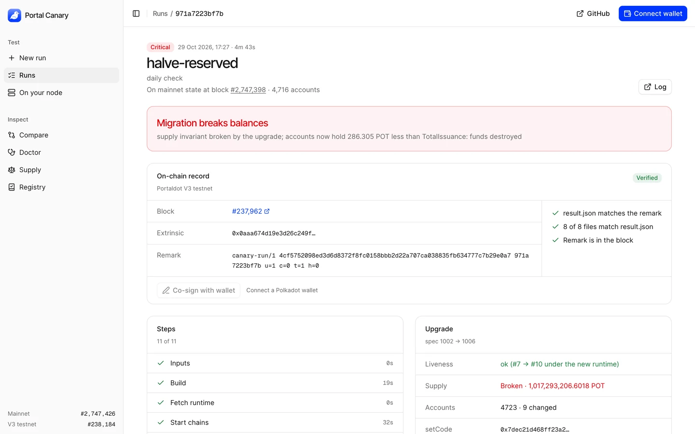
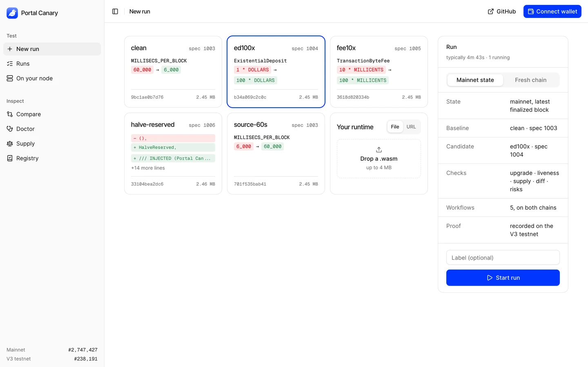
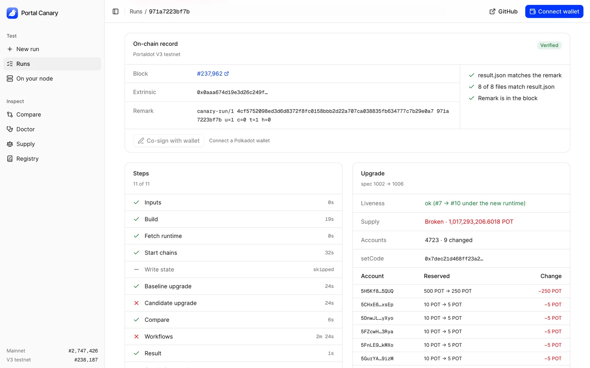
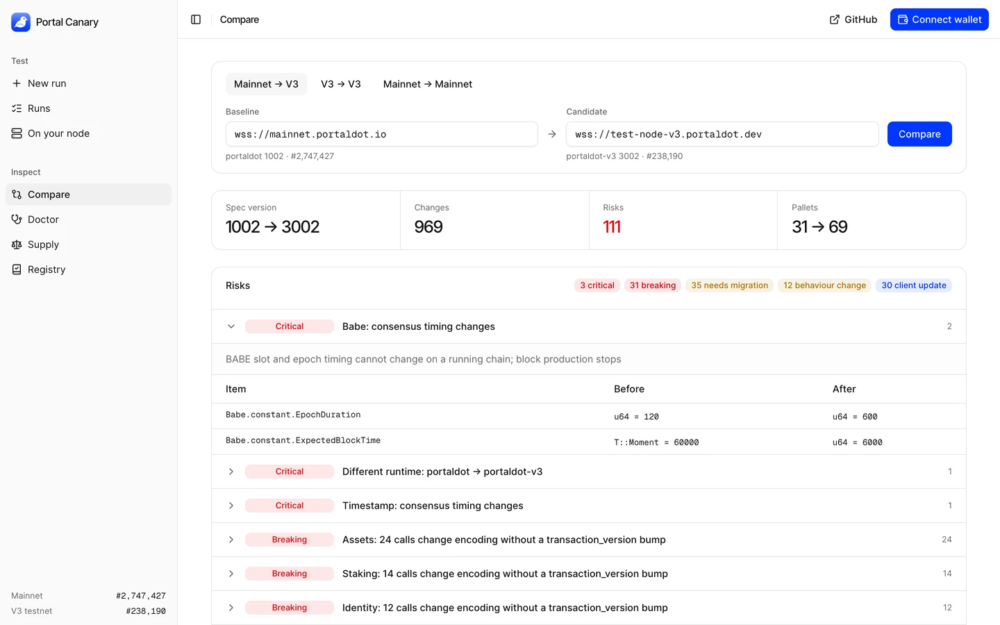

<div align="center">

# PORTAL CANARY

### Test a Portaldot runtime upgrade on a copy of today's mainnet, before it touches mainnet.

[](https://github.com/Venkat5599/portalcanary/actions/workflows/ci.yml)

[](https://portal-canary-app.vercel.app/dashboard)
[](LICENSE)


[](https://youtu.be/dV6r8IFqzck)
[](https://portal-canary-app.vercel.app/dashboard)
[](https://portal-canary-app.vercel.app/deck)
[](docs/TESTNET.md)
[](#verify-every-claim-in-one-command)
[](#whats-real-vs-pending--the-honesty-table)
[](#full-command-reference)

</div>

Portal Canary takes a candidate runtime, forks Portaldot mainnet at its latest finalized block, upgrades the fork with `system.setCode`, and checks what happened to every real account. It also checks whether blocks kept coming, what changed in the runtime's interface, and whether the workflows people rely on still behave. Every run's files are hashed into one result, and that result is written to the V3 testnet as a `system.remark`. The run page re-checks the record in your browser, and one keyless script re-checks every run ever made.

```text
setCode accepted  ≠  blocks kept coming  ≠  every balance survived
```

An upgrade can pass the first two and still destroy money. Portal Canary checks all three.

## Demo video

[](https://youtu.be/dV6r8IFqzck)

Click the image to watch on YouTube: a run against today's mainnet state, the funds-destroyed verdict, and the on-chain record checked in the browser.

[](docs/screenshots/run-mainnet.png)

More views in [Screenshots](#screenshots).

## Testnet deployment

| | |
|---|---|
| Network | PortaldotV3 Testnet, EVM chain id `420420777` |
| Substrate WS / EVM RPC | `wss://test-node-v3.portaldot.dev` / `https://test-evm-rpc-v3.portaldot.dev` |
| Explorer | [node-console.portaldot.dev](https://node-console.portaldot.dev) |
| `CanaryRegistry` contract | `0x62Eacc58CE0FA37F06F24074AFb7B3F22Df708FF` (deploy tx `0xadb58c0b7ff356a1304e8422b7f606782c91e39460bca2ab9ace133cc8656ed2`) |
| Run records | `system.remark` per run; latest tx `0xefc2025a569a45ce453d2f2c1446fc1094d40a01610759f7fca0214a2fad79c3` in block #238,224 |

Full details, costs, and commands to check every record: [`docs/TESTNET.md`](docs/TESTNET.md).

## Live status

Read on 29 Oct 2026 at mainnet #2,747,431 and V3 #238,232.

| Surface | Status | The evidence |
|---|---|---|
| Dashboard | live | [portal-canary-app.vercel.app/dashboard](https://portal-canary-app.vercel.app/dashboard); 38 browser checks pass against the production URL |
| Runs on mainnet state | live | run `bbbf22879a6a` forked mainnet #2,747,424 (4,716 accounts) and caught `halve-reserved` destroying 286.305 POT |
| On-chain records (V3 testnet) | 6 recorded, 6 verified | [`scripts/verify-runs.sh`](scripts/verify-runs.sh) output [below](#verify-every-claim-in-one-command); latest record in V3 block #238,224 |
| Kept run files | 17 runs | every run's files as `<id>.zip` on the [`runs` release](https://github.com/Venkat5599/portalcanary/releases/tag/runs) |
| Daily check | scheduled, 08:00 IST | [`daily-check.yml`](.github/workflows/daily-check.yml); its first run found a real bug (two records clashing on a nonce), opened issue #1, and closed it after the fix |
| Compare engine | live | mainnet → V3: 969 changes, 111 risks (3 critical); mainnet → mainnet: 0 and 0 |
| `CanaryRegistry` (V3 EVM) | deployed | 2,614 bytes of code at `0x62Eacc58CE0FA37F06F24074AFb7B3F22Df708FF`; the dashboard's Registry view reads it live |
| CI | green | backend, frontend, `dashboard-e2e` and `integration` (which forks mainnet and requires the injected migration to be caught) |

## The 20-second pitch

A runtime upgrade on Portaldot is one `setCode` call. The chain accepts it, `spec_version` goes up, blocks keep coming, and nothing flags a migration that quietly rewrote balances. Portaldot mainnet also runs a 2021 runtime with metadata V13, which current Substrate tooling can't decode.

Portal Canary handles V13 and V14 with its own decoder, so it can read mainnet. It forks mainnet's real state into a local chain in under 15 seconds, applies the upgrade there, and diffs every account, the supply, the runtime's interface and five end-to-end workflows. The verdict comes with evidence, and the record is on-chain.

```text
candidate .wasm ──► fork mainnet @ finalized block ──► setCode on the fork
                                                           │
       ┌───────────────────────────────────────────────────┤
       ▼                     ▼                     ▼                   ▼
 every account +      blocks still        runtime diff +        5 workflows on
 supply, before       produced under      compatibility         baseline and
 vs after             the new runtime     risks                 candidate
       └───────────────────────────────────────────────────┬───────────────┘
                                                           ▼
                 result.json (sha256 of every file) ──► system.remark on V3
                                                           ▼
                        run page re-verifies it · scripts/verify-runs.sh re-verifies all
```

## Table of contents

- [Demo video](#demo-video)
- [Testnet deployment](#testnet-deployment)
- [Live status](#live-status)
- [See it in one command](#-see-it-in-one-command)
- [Screenshots](#screenshots)
- [Verify every claim in one command](#verify-every-claim-in-one-command)
- [What Portal Canary is NOT](#what-portal-canary-is-not)
- [The problem I set out to solve](#the-problem-i-set-out-to-solve)
- [What I built](#what-i-built)
- [Architecture](#architecture)
- [The run loop, step by step](#the-run-loop-step-by-step)
- [Where the guarantee is enforced](#where-the-guarantee-is-enforced)
- [What the risk engine measures](#what-the-risk-engine-measures)
- [Engineering decisions & the traps that taught me something](#engineering-decisions--the-traps-that-taught-me-something)
- [What's real vs pending — the honesty table](#whats-real-vs-pending--the-honesty-table)
- [Attack → test](#attack--test)
- [The app](#the-app)
- [Limitations](#limitations)
- [Security](#security)
- [Tech stack](#tech-stack)
- [Project layout](#project-layout)
- [Full command reference](#full-command-reference)
- [How I'd deploy it](#how-id-deploy-it)
- [Results and supporting records](#results-and-supporting-records)
- [Tests](#tests)
- [License](#license)

## ▶ See it in one command

Start a run of the injected migration bug against today's mainnet state:

```bash
curl -X POST https://portal-canary-app.vercel.app/api/runs \
  -H 'content-type: application/json' \
  -d '{"candidate":"halve-reserved","state":"mainnet"}'
```

```text
{"id":"bbbf22879a6a"}
```

About five minutes later, [`/dashboard#run/bbbf22879a6a`](https://portal-canary-app.vercel.app/dashboard#run/bbbf22879a6a) has the verdict. These are the run's own `upgrade.txt` and `attest.txt`, copied from its [kept zip](https://github.com/Venkat5599/portalcanary/releases/download/runs/bbbf22879a6a.zip):

```text
before     spec_version 1002
events     system.CodeUpdated, sudo.Sudid, system.ExtrinsicSuccess
after      spec_version 1006
liveness   ok (#7 -> #10 under the new runtime)
state      before #6 supply_conservation PASS  (4723 accounts, issuance 1017293206.60188295853852 POT, held 1017293206.60188295853852 POT)
state      after  #10 supply_conservation FAIL  (4723 accounts, issuance 1017293206.60188295853852 POT, held 1017292920.29688295853852 POT)
changed    9 accounts (9 with reserved moved):
  5H5Kf8xc1iPwVrvyoTSQMnoetKus6Dk2eY9Zsbddzc3k5QUQ  reserved 500 -> 250 (-250)
  5CHxE6t8hLnft8YVQXqb2y5nZqn497NgHHXCVBMyahBKxsEp  reserved 10 -> 5 (-5)
  5DnwJLLdBcJiQWvWQKTEUvYgkpmmuWRcuUSjsd2cq3FiyXyo  reserved 10 -> 5 (-5)
  5FZcwH1xtdhMnAN2s4yCocLW6h5dxs94fs9gcB6xfSH83Rya  reserved 10 -> 5 (-5)
  5FnLE9PJfmxuh6vG8TH2LBB57a6VrbCjmAUToutPwHMekMXo  reserved 10 -> 5 (-5)
  5GurYAGi8wpCTqaYFjYChxo1mE34ZAzcUpTQRuorpn4Q9izM  reserved 10 -> 5 (-5)
  5H3Bbm8zdwSFBcBsopVKTnxeeu67PeVLWa194nr475nnGiXY  reserved 10 -> 5 (-5)
  5HiWR45NxSH4dvXhY9gCKmQ13hnWjiRbGNLDVFEcH9DZZg8U  reserved 10 -> 5 (-5)
  5GxJ2r1y1Bh1NufkqAQDZC7McadTSABXoQwcvyG8NCBomskf  reserved 2.61 -> 1.305 (-1.305)
verdict    REGRESSION Critical: supply invariant broken by the upgrade; accounts now hold 286.305 POT less than TotalIssuance: funds destroyed

attested   canary-run/1 94b4a227c16085410e0404e30b8fee3dab76c1a7e0c5a8e5ac1c609da4fb6d66 bbbf22879a6a u=1 c=0 t=1 h=0
chain      PortaldotV3 Test (wss://test-node-v3.portaldot.dev)
tx         0xefc2025a569a45ce453d2f2c1446fc1094d40a01610759f7fca0214a2fad79c3
block      #238224 0x4fa690395afc138eb6f205dc44d6cc9e7b585412e0921653d0660154a2258998
ok   run file matches attested hash  (94b4a227c16085410e0404e30b8fee3dab76c1a7e0c5a8e5ac1c609da4fb6d66)
ok   payload rebuilt from report matches  (canary-run/1 94b4a227c16085410e0404e30b8fee3dab76c1a7e0c5a8e5ac1c609da4fb6d66 bbbf22879a6a u=1 c=0 t=1 h=0)
ok   same chain (genesis hash)  (0xd4f9acbcf7f52388d8b095abe3c198d19fc510e0343e643e87cfbccb155283bd)
ok   remark present in attested block  (0x4fa690395afc138eb6f205dc44d6cc9e7b585412e0921653d0660154a2258998)
VERIFIED
```

Those nine addresses are real mainnet accounts holding deposits. The chain kept producing blocks and `setCode` reported success; the only signal was the money. Swap `halve-reserved` for `clean` and the same run passes with 0 accounts changed (runs `4be59393add6` and `a98bc8ba5969`).

`candidate` takes `clean`, `ed100x`, `fee10x`, `halve-reserved` or `source-60s`. You can also send `{"wasm_url":"https://…/runtime.compact.wasm"}`, or post a `.wasm` file as multipart. `"state":"dev"` runs on a fresh dev chain instead of mainnet state.

## Screenshots

| | |
|---|---|
| [](docs/screenshots/new-run.png) | [](docs/screenshots/run-mainnet.png) |
| **New run**: the five runtimes built from the public source, each with its exact source change, plus your own `.wasm`. Mainnet state is the default. | **Run `971a7223bf7b`**: Critical on mainnet state at block #2,747,398 (4,716 accounts), 286.305 POT destroyed. |
| [](docs/screenshots/run-proof.png) | [](docs/screenshots/compare.png) |
| **On-chain record**: V3 block #237,962. The page checks that result.json matches the remark, 8 of 8 files match result.json, and the remark is in the block. The table lists each real account's reserved balance before and after. | **Compare** mainnet → V3: 969 changes and 111 risks (3 critical, 31 breaking, 35 needs migration, 12 behaviour change, 30 client update). The first risk is open on its before/after rows. |

## Verify every claim in one command

[`scripts/verify-runs.sh`](scripts/verify-runs.sh) needs no key and no account. For every run on the `runs` release, it downloads the zip and checks each file against the sha256 that `result.json` lists. Then `canary verify` rebuilds the remark and finds it in the recorded V3 block.

```bash
cd backend && cargo build --release && cd .. && bash scripts/verify-runs.sh
```

Real output, 29 Oct 2026:

```text
d4d8b7934db1  halve-reserved  fresh chain      upgrade=caught  tests=caught  9/9 files  V3 #234189 VERIFIED
8e364220c6ab  fee10x          fresh chain      upgrade=pass    tests=pass    9/9 files  not recorded: error: remark not included: rejected 1010: Invalid Transacti
b9f3587ffcba  halve-reserved  fresh chain      upgrade=caught  tests=caught  9/9 files  not recorded: error: remark not included: rejected 1010: Invalid Transacti
257374fa02b5  ed100x          fresh chain      upgrade=pass    tests=caught  no hash map  not recorded: no record (run predates on-chain records)
4fc6fe73ae11  fee10x          fresh chain      upgrade=pass    tests=pass    no hash map  not recorded: no record (run predates on-chain records)
a2fd31d06e7c  clean           fresh chain      upgrade=pass    tests=pass    no hash map  not recorded: no record (run predates on-chain records)
959e58764a17  url             fresh chain      upgrade=caught  tests=caught  no hash map  not recorded: no record (run predates on-chain records)
a7ef3ef0a76f  url             fresh chain      upgrade=pass    tests=pass    no hash map  not recorded: no record (run predates on-chain records)
c3d4e5f6a1b2  source-60s      fresh chain      upgrade=halted  tests=-       no hash map  not recorded: no record (run predates on-chain records)
b2c3d4e5f6a1  ed100x          fresh chain      upgrade=pass    tests=caught  no hash map  not recorded: no record (run predates on-chain records)
a1b2c3d4e5f6  ed100x          fresh chain      upgrade=-       tests=-       no hash map  not recorded: no record (run predates on-chain records)
ee094cd30f34  ed100x          fresh chain      upgrade=pass    tests=caught  9/9 files  V3 #234821 VERIFIED
3bb79f012050  halve-reserved  mainnet #2747392 upgrade=caught  tests=caught  8/8 files  not recorded: error: remark not included: rejected 1014: Priority is too l
4be59393add6  clean           mainnet #2747392 upgrade=pass    tests=pass    8/8 files  V3 #237902 VERIFIED
a98bc8ba5969  clean           mainnet #2747397 upgrade=pass    tests=pass    8/8 files  V3 #237959 VERIFIED
971a7223bf7b  halve-reserved  mainnet #2747398 upgrade=caught  tests=caught  8/8 files  V3 #237962 VERIFIED
bbbf22879a6a  halve-reserved  mainnet #2747424 upgrade=caught  tests=caught  8/8 files  V3 #238224 VERIFIED
runs 17 · recorded on V3 6 · verified 6 · failed 0
```

The unrecorded rows stay in the list on purpose. Two (`1010`) ran while the record key held no tPOT. One (`1014`) clashed on a nonce with a run that finished at the same moment; the record step now retries, and the daily check is what caught it. The oldest runs predate on-chain records. `ed100x` shows why the workflows matter: its upgrade conserves supply, yet `balances.transfer.basic` breaks because a 1 POT transfer now falls under a 100 POT existential deposit.

## What Portal Canary is NOT

- **Not a test on mainnet.** Nothing is ever sent to mainnet. `canary upgrade` refuses any chain whose node reports a chain type other than Development or Local, and mainnet reports `Live`.
- **Not a byte-exact replay of mainnet's runtime.** The fork runs mainnet's storage on the dev node's runtime, because mainnet's 60-second BABE slots can't move to a single local authority. Mainnet's own runtime and the public source differ in constants, not storage layout (see Compare).
- **Not a metadata diff alone.** A diff tells you what changed. A run tells you what that change did to real balances and real workflows.
- **Not a promise you have to trust.** Every number on a run page comes from files whose hashes are recorded on-chain, and the script above re-checks them without a key.

## The problem I set out to solve

`setCode` accepts any runtime with the right `spec_name` and a higher `spec_version`. After that, the chain's own signals say the upgrade went fine: the extrinsic succeeds, the version goes up, blocks keep coming. A migration that halves every reserved balance and leaves `TotalIssuance` alone produces none of those signals. The supply just stops adding up.

Portaldot makes this harder. Mainnet runs a 2021 runtime with **metadata V13**, and current tooling decodes V14 and up, so the usual tools can't read mainnet at all. The V3 testnet runs V14. Comparing the two, or testing an upgrade against real mainnet state, needed a decoder for both and a way to get mainnet's state into a chain that would accept a `setCode` from us.

## What I built

- **Runs on mainnet state.** [`backend/driver/src/fork.ts`](backend/driver/src/fork.ts) copies mainnet at its latest finalized block into a dev chain spec: every pallet except consensus and block history, all 4,716 accounts, 186 balance entries, 3,726 staking entries, vesting and identities. It takes 4 to 15 seconds, so every run forks current mainnet.
- **A state diff across `setCode`.** `canary upgrade` reads every account and `TotalIssuance` at a pinned block before and after, waits for three blocks under the new runtime, and lists each account that changed.
- **A compatibility risk engine.** [`risk.rs`](backend/crates/canary-chain/src/risk.rs) judges each runtime difference by severity, with a reason and the before/after rows. The same Rust code runs in the CLI, in every run, and in the browser as WebAssembly.
- **Workflow tests on both sides.** Five YAML workflows ([`backend/tests/workflows`](backend/tests/workflows)) run as signed extrinsics on the baseline and the candidate, and every expectation is compared.
- **Proof.** `result.json` carries the sha256 of every other file. `canary attest` writes its hash to V3 as a remark, the run page re-checks it, and [`scripts/verify-runs.sh`](scripts/verify-runs.sh) re-checks all runs.
- **A daily check.** Every day `clean` must pass and `halve-reserved` must be caught, both on mainnet state. A failure opens a GitHub issue, and a pass closes it.
- **A dashboard** built on shadcn/ui: New run, Runs, run pages, Compare between any two nodes, an endpoint Doctor, the mainnet Supply invariant, the Registry contract, and On your node for running the suite against your own node with a wallet.

## Architecture

```text
 browser (Next.js + shadcn/ui)                      GitHub
 ─────────────────────────────                      ──────
 New run ──POST /api/runs──► Vercel function ──dispatch──► canary-run.yml (ubuntu runner)
 Run page ◄─GET /api/runs/:id── reads steps, then          ├─ fork.ts: mainnet state → fork.json
                                 runs/<id>.zip             ├─ 2 × portaldot_dev (baseline, candidate)
                                                           ├─ canary upgrade / compare / test
 Compare ── canary.wasm ──WebSocket──► any two nodes       ├─ result.json (sha256 of every file)
 Proof card ──WebSocket──► V3 block (re-checks remark)     ├─ canary attest + verify ──► V3 testnet
                                                           └─ runs/<id>.zip on the `runs` release
 daily-check.yml (cron) ──dispatch──► canary-run.yml ×2 ──► judge ──► open / close an issue
```

### Component by component

| Component | Where | What it does |
|---|---|---|
| `canary-chain` | [`backend/crates/canary-chain`](backend/crates/canary-chain) | V13 and V14 metadata decoder, SCALE codecs for accounts and issuance, structural diff, risk engine, JSON-RPC over WebSocket |
| `canary` CLI | [`backend/crates/canary-cli`](backend/crates/canary-cli) | `doctor`, `invariants`, `compare`, `test`, `reproduce`, `upgrade`, `attest`, `verify` |
| `canary-wasm` | [`backend/crates/canary-wasm`](backend/crates/canary-wasm) | the decoder, diff and risk engine compiled to WebAssembly (about 330 KB) for Compare |
| driver | [`backend/driver`](backend/driver) | signs and submits workflow steps; `fork.ts` builds the mainnet fork spec |
| run workflow | [`.github/workflows/canary-run.yml`](.github/workflows/canary-run.yml) | one run: fork or fresh chains, upgrade, compare, test, result, record, keep |
| daily check | [`.github/workflows/daily-check.yml`](.github/workflows/daily-check.yml) | two runs a day with expected outcomes, and issue alerts |
| dashboard | [`frontend/components/dashboard`](frontend/components/dashboard) | shadcn/ui views; run pages rebuild and re-check the on-chain record |
| `CanaryRegistry` | [`contracts/src/CanaryRegistry.sol`](contracts/src/CanaryRegistry.sol) | verdict registry on the V3 EVM |

### HTTP surface

| Route | Does |
|---|---|
| `POST /api/runs` | starts a run. JSON `{candidate \| wasm_url, state, label}` or multipart with a `.wasm` up to 4 MB. Returns `202 {"id"}`. Refuses unknown candidates, non-https URLs, non-wasm files and bad `state` with a 400, and returns 429 when 3 runs are already in progress |
| `GET /api/runs` | recent runs from Actions, plus older ones kept on the `runs` release, newest first |
| `GET /api/runs/:id` | the run, its steps and, once finished, every result file |

## The run loop, step by step

1. **Check inputs.** Run id, candidate name or https URL, and `state` (`mainnet` or `dev`).
2. **Get the candidate.** Built runtimes are checked against [`SHA256SUMS`](backend/runtimes/out/SHA256SUMS). An uploaded file or URL is fetched with a 16 MB cap.
3. **Start two chains.** On mainnet state, `fork.ts` writes `fork-meta.json` (block, hash, account count, issuance) and both nodes start from the same `fork.json` with `--no-mdns --reserved-only`, so they can't peer. On a fresh chain, accounts with reserved deposits are written in first, so a migration has something to break.
4. **Upgrade the baseline** to `clean`, so both sides run the same codebase and differ only in what the candidate changes.
5. **Upgrade the candidate**: before and after snapshots of every account and the supply, plus liveness over three blocks. Exit 1 means it found a problem; exit 2 means it could not decide.
6. **Compare** the two upgraded runtimes and judge the risks.
7. **Run the five workflows** on both chains.
8. **Write `result.json`** with exit codes, the starting state and the sha256 of every file.
9. **Record it on V3** with `canary attest`, retrying a nonce clash, then check it with `canary verify`.
10. **Keep the files** as `<id>.zip` on the `runs` release, which outlives the 30-day artifact.

## Where the guarantee is enforced

| Guarantee | Module | The test that covers it |
|---|---|---|
| A migration that destroys funds is Critical, whatever else passes | [`upgrade.rs`](backend/crates/canary-cli/src/upgrade.rs) | `halved_reserve_is_a_critical_regression` |
| Fees moving between accounts are not a false alarm | [`upgrade.rs`](backend/crates/canary-cli/src/upgrade.rs) | `fees_moving_between_accounts_conserve_supply` |
| A chain that was already out of balance is inconclusive, not blamed on the upgrade | [`upgrade.rs`](backend/crates/canary-cli/src/upgrade.rs) | `pre_existing_imbalance_is_inconclusive` |
| `setCode` is never sent to a live network | [`upgrade.rs`](backend/crates/canary-cli/src/upgrade.rs) | `set_code_only_on_dev_or_local_chains` |
| The mainnet fork conserves supply, and the injected migration is caught on real deposits | [`ci.yml`](.github/workflows/ci.yml) `integration` | step "mainnet fork (real state, local authority)" |
| The page rebuilds the exact bytes the CLI records | [`runresult.ts`](frontend/lib/runresult.ts), [`attest.rs`](backend/crates/canary-cli/src/attest.rs) | `run_payload_from_result_json`; "run remark rebuilt in the page matches the CLI" |
| A run page shows a record only if the files, the result and the block agree | [`Proof.tsx`](frontend/components/dashboard/Proof.tsx) | "run page: verdict, risks and the on-chain record re-verified in the browser" |
| A runtime compared with itself has no changes and no risks | [`risk.rs`](backend/crates/canary-chain/src/risk.rs) | `identical_runtimes_have_no_risk`; "compare: a chain against itself has no changes and no risks" |
| Additions alone are never a risk | [`risk.rs`](backend/crates/canary-chain/src/risk.rs) | `additions_alone_carry_no_risk` |
| Live-chain runs on your node never fund an account with more than 5 tokens | [`tx.ts`](frontend/lib/tx/tx.ts) | "live-chain cap keeps only workflows that fit in 5 tokens per account" |
| The canary still catches what it exists for, every day | [`daily-check.yml`](.github/workflows/daily-check.yml) | the `halve-reserved` run must report funds destroyed |

## What the risk engine measures

Every difference between two runtimes goes through the rules in [`risk.rs`](backend/crates/canary-chain/src/risk.rs). Each risk has a severity, the reason, and the before/after rows it rests on, grouped per pallet.

| Severity | Rule | Fires when | Test |
|---|---|---|---|
| Critical | `spec-name`, `spec-version` | `setCode` would refuse the runtime | `different_spec_name_cannot_be_applied`, `spec_version_must_increase` |
| Critical | `consensus-constant` | BABE epoch or slot, or the timestamp period, changes | `consensus_timing_is_critical` |
| Breaking | `call-encoding` | a pallet index, call index or signature changes, or a call or pallet is removed, without a `transaction_version` bump | `moved_call_without_tx_bump_is_breaking`, `pallet_index_and_removed_pallet_are_encoding_changes` |
| Needs migration | `storage-type`, `storage-removed` | a storage item changes type or disappears | `storage_type_change_needs_migration` |
| Behaviour change | `constant` | a constant changes value (`System.Version` excluded, it changes on every upgrade) | `runtime_version_constant_is_not_a_risk` |
| Client update | `event`, `error`, `runtime-api` | events or errors are removed or renumbered, or a runtime API is removed or re-versioned | `constants_events_errors_apis` |

Mainnet → V3, read live:

```text
$ canary compare --baseline wss://mainnet.portaldot.io --candidate wss://test-node-v3.portaldot.dev
baseline   wss://mainnet.portaldot.io  spec portaldot#1002  metadata b87080f9349f936e…
candidate  wss://test-node-v3.portaldot.dev  spec portaldot-v3#3002  metadata 6b83f7276635d3c4…
pallets    31 vs 69
…
CRITICAL   Babe: consensus timing changes  [consensus-constant]
           BABE slot and epoch timing cannot change on a running chain; block production stops
           Babe.constant.EpochDuration u64 = 120 (0x7800000000000000) -> u64 = 600 (0x5802000000000000)
           Babe.constant.ExpectedBlockTime T::Moment = 60000 (0x60ea000000000000) -> u64 = 6000 (0x7017000000000000)
CRITICAL   Different runtime: portaldot → portaldot-v3  [spec-name]
           setCode rejects a runtime with a different spec_name (InvalidSpecName); this cannot be applied as an upgrade of the baseline chain
           runtime.spec_name "portaldot" -> "portaldot-v3"
BREAKING   Staking: 14 calls change encoding without a transaction_version bump  [call-encoding]
           wallets and signers that cached the old metadata will build transactions the new runtime decodes as a different call or rejects
           Staking.index 9 -> 11
…
969 change(s), 111 risk(s)
```

V3 is a new chain, not an upgrade of mainnet: applied to mainnet it would halt block production and change every staking call's encoding.

## Engineering decisions & the traps that taught me something

- **Write a decoder instead of waiting for tooling.** Mainnet's V13 metadata is unreadable to current libraries, so `canary-chain` decodes V13 and V14 itself and speaks raw JSON-RPC and SCALE. That one decision is what lets Compare put mainnet and V3 side by side.
- **An empty chain can't fail a migration.** The first `halve-reserved` run passed. A fresh dev chain had no reserved balances, so halving them changed nothing. Runs now start from mainnet state, or write deposits into a fresh chain first. That passing run is still on the list (`a7ef3ef0a76f`).
- **Most of mainnet's state is one pallet nobody needs.** A full key scan reached 765,000 keys in 150 seconds and kept going. Almost all of it was `MerkleMountainRange`, two nodes per block. Skipping it and the other block-history pallets took the fork down to 8,723 keys and about 6 MB.
- **The library's paged-key call returned nothing on this node.** `getKeysPaged(prefix, n, undefined, at)` came back empty for every pallet, while the raw `state_getKeysPaged` with `null` worked. `fork.ts` talks raw JSON-RPC.
- **A fork must not elect validators it has no keys for.** Mainnet's staking state would plan an era from mainnet validators, whose session keys aren't on the fork, leaving no block author. `fork.ts` sets `Staking.ForceEra = ForceNone`. The dev epoch is 1,200 blocks, so no session rotates during a run.
- **The fork's supply has to add up before the test starts.** The dev signers are added to `System.Account`, and their balances to `TotalIssuance`. Otherwise every run would open with a broken invariant and blame the candidate.
- **Two runs signed with one key at the same moment.** The daily check's first run found it: V3 rejected the second record with `1014 Priority is too low`. The record step now retries after a short random wait.
- **`setCode` going through proves nothing.** The unmodified public source is accepted by the 6-second dev chain, and then block production stops for good with `Timestamp slot must match CurrentSlot`. That's why liveness is a check and slot timing is a Critical risk.
- **A root-level ignore rule hid two folders.** `.gitignore` had `runs/`, which silently ignored `frontend/app/api/runs/` and its route files. It's now `/runs/` and `/backend/runs/`.

## What's real vs pending — the honesty table

| Claim | Status |
|---|---|
| Runs fork mainnet's real state at its latest finalized block | real; every mainnet-state run's `fork-meta.json` names the block and hash |
| `halve-reserved` destroys 286.305 POT across 9 real accounts on mainnet state | real; runs `971a7223bf7b` and `bbbf22879a6a`, both recorded on V3 |
| Every recorded run verifies | real; 6 of 6 in the script output above |
| Every run is recorded on V3 | **no**: 11 of 17 kept runs aren't. 8 predate records, 2 ran while the key had no tPOT, and 1 clashed on a nonce before the retry existed |
| The fork runs mainnet's exact runtime | **no**: mainnet's storage, on the dev node's runtime and consensus. Mainnet's runtime and the public source differ in constants, not storage layout |
| Upgrades are tested on mainnet itself | **no, by design**: `setCode` is refused on any `Live` chain |
| The `injected` runtimes are Portaldot bugs | **no**: `ed100x`, `fee10x` and `halve-reserved` are test runtimes with labelled, committed patches |
| The daily check runs every day | scheduled; ran twice on 29 Oct 2026 (first failed on the nonce clash, second passed) |
| On your node runs the suite on your own node | real for a local dev node or a funded wallet on V3; the hosted site can't reach a node you don't run |
| The record key's balance | 10 tPOT funded on 29 Oct 2026; one record costs about 0.022 tPOT |

## Attack → test

| The abuse | The test that answers it |
|---|---|
| A migration halves deposits and leaves `TotalIssuance` alone | `halved_reserve_is_a_critical_regression`; the CI fork step; the daily check |
| A runtime that halts the chain once applied | liveness over three blocks (`source-60s`, run `c3d4e5f6a1b2`: halted); `consensus_timing_is_critical` |
| An edited result file after the run | `result.json` hashes every file and V3 holds `result.json`'s hash; "run page: verdict, risks and the on-chain record re-verified in the browser"; `scripts/verify-runs.sh` |
| A run page pointing at a remark from another chain | `canary verify` compares the genesis hash ("same chain (genesis hash)") |
| Pointing the dashboard at mainnet to upgrade it | `set_code_only_on_dev_or_local_chains`; mainnet reports `Live` |
| An http URL, a non-wasm file or a garbage endpoint | "compare: refuses bad input with a reason"; "new run: lists the built runtimes and refuses a non-wasm file"; 400s from `POST /api/runs` |
| A false alarm from fees moving between accounts | `fees_moving_between_accounts_conserve_supply` |
| A diff that cries wolf on additions | `additions_alone_carry_no_risk` |
| The canary itself silently stops catching bugs | the daily `halve-reserved` run must still report funds destroyed |
| Run results vanishing after 30 days | files kept on the `runs` release, read first by the API |

## The app

| View | What you do there |
|---|---|
| **New run** | pick a built runtime (each card shows its source change), drop a `.wasm`, or paste a URL; choose Mainnet state or Fresh chain; Start run |
| **Runs** | every run, newest first, with its verdict and starting state |
| **Run page** | live steps, the verdict, the upgrade's account table, risks, workflow results, and the On-chain record card with its explorer link |
| **Compare** | any two nodes, with presets for Mainnet → V3, V3 → V3 and the Mainnet → Mainnet control |
| **Doctor** | public endpoints checked layer by layer: DNS, TCP, WebSocket, RPC, runtime APIs |
| **Supply** | mainnet's `TotalIssuance` against the sum of all 4,716 accounts |
| **Registry** | the `CanaryRegistry` contract on the V3 EVM, read live |
| **On your node** | the workflow suite as real signed extrinsics against your node; a wallet signs on V3 |

The landing page at [portal-canary-app.vercel.app](https://portal-canary-app.vercel.app) reads its numbers live from mainnet and V3.

## Limitations

- The fork runs mainnet's state on the dev node's runtime and 6-second consensus. A bug that only shows under mainnet's exact runtime or its 60-second slots won't show here.
- Contract child tries aren't copied. Mainnet has no contracts today (`Contracts.ContractInfoOf` is empty), so nothing is missing yet.
- Runs need GitHub Actions and a token on the server, so the hosted dashboard starts runs only on this repository.
- On your node needs a node the browser can reach. The hosted page can't see a node behind someone else's firewall.
- Records cost tPOT. When the key runs out, runs still complete and the page says why the run wasn't recorded.

## Security

- **No mainnet writes.** The upgrade path refuses non-dev chains, and the fork's nodes take no peers (`--reserved-only --no-mdns`).
- **Secrets stay server-side.** `CANARY_GH_TOKEN` lives only in the Vercel function's environment. `CANARY_ATTEST_SEED` lives only in GitHub Actions secrets, `attestation.json` records the signer as `env`, and the seed never touches a file.
- **Uploads are checked.** Files must start with the WebAssembly or compressed-runtime magic, are capped at 4 MB, and are stored under the run's id. URLs must be https.
- **At most 3 runs at once** (`MAX_ACTIVE`), so a burst of requests can't queue unlimited Actions minutes or records.
- **The record key holds only what it spends.** It was funded with 10 tPOT, about 450 records.

| Secret | Where | Needs |
|---|---|---|
| `CANARY_GH_TOKEN` | Vercel, server only | Actions read/write (start and read runs) and Contents read/write (store uploaded runtimes as release assets), on this repository only |
| `CANARY_ATTEST_SEED` | GitHub Actions | a V3 account with a little tPOT; it signs each run's record |

## Tech stack

| Layer | Built with |
|---|---|
| Engine | Rust: own V13/V14 metadata decoder and SCALE codecs, `tungstenite`, `serde`, `blake2`, `twox-hash`, `clap` |
| Browser engine | the same crates compiled to `wasm32-unknown-unknown` ([`scripts/build-wasm.sh`](scripts/build-wasm.sh)) |
| Driver and fork | Bun, `@polkadot/api` |
| Runs | GitHub Actions on `ubuntu-22.04`, the public Portaldot dev node binary |
| Web | Next.js, React, Tailwind CSS v4, shadcn/ui, lucide icons |
| Contract | Solidity, Foundry |
| Tests | `cargo test`, `bun test`, Playwright, `forge test` |

## Project layout

```text
.github/workflows/
  canary-run.yml        one run (mainnet state or fresh chain)
  daily-check.yml       two runs a day with expected outcomes, issue alerts
  ci.yml                backend, frontend, dashboard-e2e, integration (incl. the mainnet fork)
backend/
  crates/canary-chain   decoder, diff, risk engine, RPC                  29 tests
  crates/canary-cli     the canary CLI                                   10 tests
  crates/canary-wasm    the engine as WebAssembly                         2 tests
  driver/src/run.ts     signs and submits workflow steps
  driver/src/fork.ts    mainnet state → dev chain spec
  tests/workflows/      the five YAML workflows
  runtimes/             build.sh and the five built runtimes with their patches
frontend/
  app/                  landing, /dashboard, /api/runs
  components/dashboard/ shadcn/ui views
  lib/                  runs, run results, tx engine, wallet
  tests/                unit tests                                        32 tests
  e2e/                  Playwright, desktop and phone                     19 tests × 2
contracts/              CanaryRegistry (Foundry)                           4 tests
scripts/                verify-runs.sh, build-wasm.sh, demos
examples/               recorded CLI outputs and reports
docs/                   architecture, plan, V3 readiness log, screenshots
action.yml              GitHub Action: canary test in any repo's CI
```

## Full command reference

Build (Linux, WSL2 or macOS):

```bash
cd backend && cargo build --release
```

| Command | Does | Exit codes |
|---|---|---|
| `canary doctor --ws <url>… [--eth <url>…]` | layer-by-layer endpoint check and runtime fingerprint | 0 healthy, 2 unhealthy |
| `canary invariants --ws <url> [--at <hash>]` | supply conservation at one pinned block | 0 pass, 1 fail, 2 inconclusive |
| `canary compare --baseline <url> --candidate <url> [--json]` | runtime diff and compatibility risks | 0 no upgrade hazard, 1 a change would halt a running chain |
| `canary upgrade --ws <url> --wasm <file> [--out <json>]` | `setCode` on a dev or forked chain, with state diff and liveness | 0 pass, 1 regression, 2 inconclusive |
| `canary test --baseline <url> --candidate <url> --out <dir>` | the workflow suite on both sides | 0 pass, 1 regression, 2 inconclusive |
| `canary reproduce …` | re-run one finding by its hash | |
| `canary attest --run <dir> --ws <url> --signer <alice\|//Name\|env>` | record a run's result on-chain; `env` signs with `CANARY_SIGNER_URI` | |
| `canary verify --run <dir>` | re-check a record: file hash, payload, chain, block | 0 verified |
| `bun backend/driver/src/fork.ts --dev-spec dev.json --out fork.json --meta fork-meta.json` | build a mainnet fork chain spec | |
| `bash scripts/verify-runs.sh` | re-check every kept run, keyless | 0 all recorded runs verify |

Mainnet supply, read live on 29 Oct 2026:

```text
$ canary invariants --ws wss://mainnet.portaldot.io
invariant  supply_conservation  (wss://mainnet.portaldot.io)
  block           #2747429 0xd3a8859206bb2ac73ac40537b065c1fa8868691c32733800c29c493c1d6df3cf
  accounts        4716 (layouts: {"with_sufficients": 4716}, decode errors: 0)
  sum free        1016942633.99188295853852 POT
  sum reserved    572.61 POT
  sum total       1016943206.60188295853852 POT
  total issuance  1016943206.60188295853852 POT
  delta           +0 planck
  verdict         PASS
```

Run a mainnet fork yourself:

```bash
curl -LO https://github.com/portaldotVolunteer/Portaldot-node/raw/main/portaldot-testnet-ubuntu.tar.gz
tar -xzf portaldot-testnet-ubuntu.tar.gz
NODE=./portaldot-testnet-ubuntu/portaldot_dev
$NODE build-spec --dev --raw > dev.json
(cd backend/driver && bun install && bun src/fork.ts --dev-spec ../../dev.json --out ../../fork.json --meta ../../fork-meta.json)
$NODE --chain fork.json --alice --validator --force-authoring --tmp --no-mdns --reserved-only --ws-port 9946
backend/target/release/canary upgrade --ws ws://127.0.0.1:9946 --wasm backend/runtimes/out/halve-reserved.compact.wasm
```

The site: `cd frontend && bun install && bun run dev`. Tests: `bun test tests`, then `bun run build && npx playwright test`.

## How I'd deploy it

The site is a Next.js app on Vercel with one server secret, `CANARY_GH_TOKEN`. The runs execute on GitHub Actions in this repository and need `CANARY_ATTEST_SEED` plus a few tPOT on that key. To run it for another repository, fork it, set both secrets, point `REPO` in [`frontend/lib/runs.ts`](frontend/lib/runs.ts) at the fork, and deploy `frontend/`. The daily check starts on its own schedule once the workflow file is on the default branch.

## Results and supporting records

| Record | Where |
|---|---|
| Every dashboard run's files | [`runs` release](https://github.com/Venkat5599/portalcanary/releases/tag/runs), one zip per run id |
| Mainnet vs V3 comparison | [`examples/mainnet-vs-v3`](examples/mainnet-vs-v3) |
| Upgrade runs on dev chains (ed100x, fee10x, halve-reserved) | [`examples/upgrade-ed100x`](examples/upgrade-ed100x), [`examples/upgrade-fee10x`](examples/upgrade-fee10x), [`examples/upgrade-halve-reserved`](examples/upgrade-halve-reserved) |
| Determinism control | [`examples/self-compare`](examples/self-compare) |
| The built runtimes, their patches and hashes | [`backend/runtimes/out`](backend/runtimes/out) |
| Demo video | [youtu.be/dV6r8IFqzck](https://youtu.be/dV6r8IFqzck) |
| Testnet development: endpoints, records, contract, verification | [`docs/TESTNET.md`](docs/TESTNET.md) |
| Hackathon submission write-up | [`docs/DORAHACKS.md`](docs/DORAHACKS.md) |
| V3 endpoint checks and earlier V3 records | [`docs/V3_READINESS.md`](docs/V3_READINESS.md) |
| Design notes | [`docs/ARCHITECTURE.md`](docs/ARCHITECTURE.md), [`docs/PLAN.md`](docs/PLAN.md) |
| Pitch deck | [portal-canary-app.vercel.app/deck](https://portal-canary-app.vercel.app/deck), PDF copy [`docs/Portal-Canary-Venkat.pdf`](docs/Portal-Canary-Venkat.pdf) |

## Tests

115 passing: 41 Rust, 32 unit, 38 browser and 4 contract.

| Suite | Count | Covers |
|---|---|---|
| `canary-chain` | 29 | decoder, diff, every risk rule |
| `canary-cli` | 10 | upgrade verdicts, the chain-type guard, the run record payload |
| `canary-wasm` | 2 | a bad request or undecodable metadata returns a named error, never a panic |
| Frontend unit (`bun test tests`) | 32 | landing markup, served reports, the page-built record matches the CLI, workflow funding cap, run titles |
| Browser (`npx playwright test`) | 38 | 19 tests on desktop and phone: every view, Compare on real nodes, refused input, Supply, Doctor, runs, a run's on-chain record, a mainnet-state run |
| Contract (`forge test`) | 4 | `CanaryRegistry` attest, duplicates, empty reports, clean status |

CI also runs the integration job against a real Portaldot dev node: doctor, compare against live mainnet, a determinism control, and the mainnet fork with the injected migration.

The Rust crates use `tungstenite`, `ureq`, `native-tls`, `blake2`, `sha2`, `twox-hash`, `serde`, `serde_json`, `serde_yaml`, `clap`, `anyhow`, `hex` and `url`. The driver uses `@polkadot/api`, `@polkadot/keyring` and `@polkadot/util-crypto` (Apache-2.0).

## License

Apache-2.0. See [LICENSE](LICENSE).
