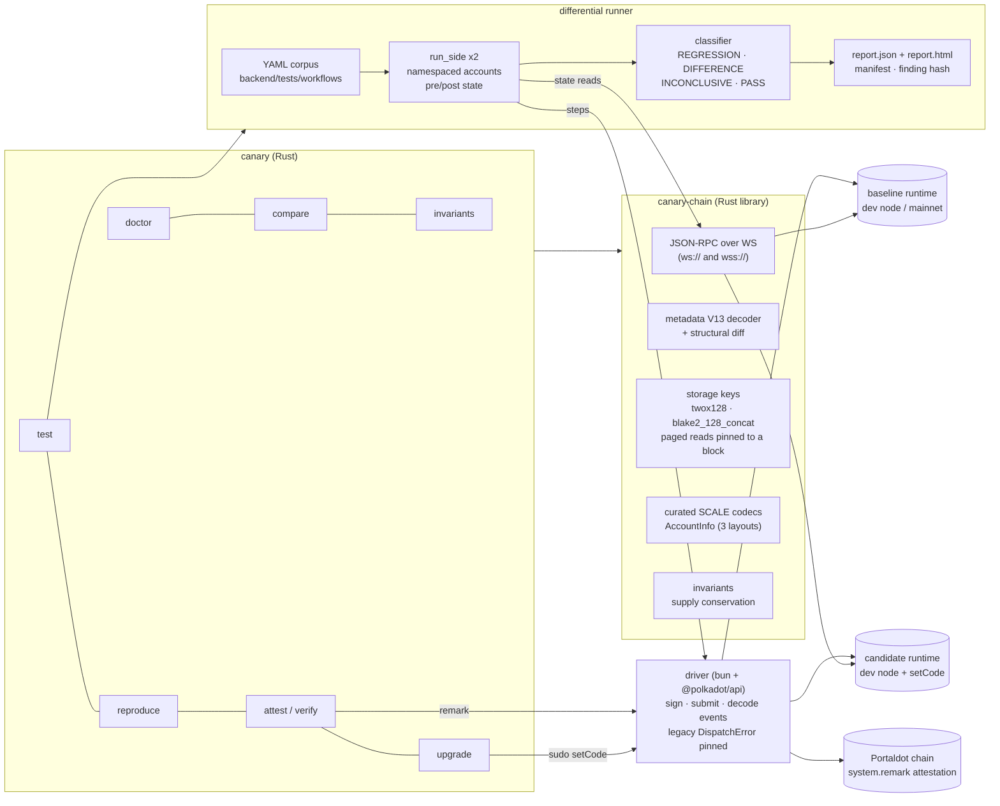

# Architecture

## Boundaries

| Component | Responsibility | Why it is separate |
|---|---|---|
| `canary-chain` | Raw JSON-RPC, SCALE, metadata V13, storage, invariants | Portaldot runs metadata V13; modern `subxt` cannot decode it. No dependency on Substrate crates, so it builds anywhere |
| `canary-cli` | Commands, runner, classifier, reports, attestation | Usable in CI without any UI |
| `backend/driver/` | Signing, submission, event decoding | `@polkadot/api` already handles V13 extrinsic formats; Canary pins the one type it gets wrong |
| `backend/runtimes/` | Building candidate WASM from the public source with a pinned 2021 toolchain | Reproducible candidates with recorded patches and hashes |

## Trust model

- Candidate runtimes and workflows are untrusted. They run only on local `--dev --tmp` nodes; `upgrade` and `inject` refuse non-development chains.
- No secrets in args, logs or reports. Real-network signing uses `--signer env` with `CANARY_SIGNER_URI`.
- Every result is pinned to block hashes; every run records runtime ids (spec, metadata sha256, genesis) and corpus file hashes.
- Verdicts are conservative: an undecodable block or a baseline failure is **INCONCLUSIVE**, never PASS. Reports never call an upgrade "safe".
